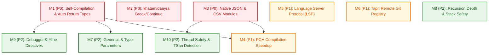

# MEMElang Master Implementation Plan: 10 Prioritized Problems

**Document Version**: 1.0.0  
**Status**: APPROVED FOR EXECUTION  
**Author**: teamwork_worker_plan  
**Date**: 2026-11-12  
**Target Repository**: `/Volumes/Development/C++/GOAT Lang`  
**Execution Mode**: Dual-Execution Engine (Tree-Walking Interpreter & Native AOT Transpiler)

---

## 1. Document Overview & System Architecture

### 1.1 Executive Summary

MEMElang is a dual-execution programming language combining an expressive Hindi/English ("Hinglish") syntax with high-performance execution. It operates two distinct compilation and runtime pipelines:
1. **Tree-Walking Interpreter & Gradual TypeChecker**: Interactive REPL, step-by-step AST interpreter (`Interpreter.cpp`), environment scoping (`Environment.h`), dynamic values (`Value.h`), and built-in runtime modules.
2. **Native AOT Transpiler & Self-Hosted Toolchain**: C++20 source-to-source code generator (`NativeCompiler.cpp`), zero-dependency header-only runtime library (`MemeRuntime.h`), and a self-hosted compiler written entirely in MEMElang (`compiler.meme`).

A comprehensive architectural and empirical audit across the codebase has identified 10 prioritized problems spanning critical compiler blockers (P0), developer experience and tooling gaps (P1), and language robustness deficiencies (P2).

| # | Priority | Problem / Subsystem | Core Failure Mechanism | Impact / Remedy |
|---|---|---|---|---|
| **M1** | **P0** | **Native Compiler Self-Compilation & Auto Return Types** (`NativeCompiler.cpp`, `MemeRuntime.h`) | C++20 `[dcl.type.auto.deduct]` prohibits member function calls with undeduced `auto` return types before their definition. Pass 1 (classes) precedes Pass 2 (functions) with no forward declarations. Unannotated null initializers deduce `std::nullptr_t`. Ambiguous `size_t` assignment in `MemeValue`. | **BLOCKER**: Self-hosted `compiler.meme` fails to compile natively with 20+ Clang++ errors. Resolved via Pass 0 forward declarations, default `MemeValue` return signatures, and `size_t` conversions. |
| **M2** | **P0** | **`khatam`/`daayra` (Break/Continue) in Self-Hosted Compiler** (`compiler.meme`, `Parser.h`) | `khatam` and `daayra` are omitted from `compiler.meme::init_keywords()`, lexing as `IDENT` and emitting literal C++ identifiers `khatam;` / `daayra;`. In host C++, `khatam` triggers `DROP` expecting an expression, and `daayra` triggers `SCOPE` expecting `{`. | **BLOCKER**: Loop control statements in self-hosted scripts emit broken C++ code. Resolved by mapping keywords in `compiler.meme` and supporting standalone semicolon delimiters in `Parser.h`. |
| **M3** | **P0** | **Native Runtime JSON & CSV Modules** (`MemeRuntime.h`, `NativeCompiler.cpp`) | `JsonModule` and `CsvModule` exist in the interpreter but are completely absent from `MemeRuntime.h`. `NativeCompiler.cpp` ignores `json`/`csv` imports and fails on dynamic property access. | **BLOCKER**: Native benchmarks `bench_json.meme` and `bench_csv.meme` fail to compile. Resolved by embedding zero-dependency RFC-compliant JSON/CSV engines and `meme_index` property access into `MemeRuntime.h`. |
| **M4** | **P1** | **Compilation Speedup via Precompiled Headers (PCH)** (`NativeCompiler.cpp`, `compiler.meme`) | `#include "src/compiler/MemeRuntime.h"` re-parses 18 STL headers and 2,113 lines of C++20 templates on every single compilation, incurring a ~1,524ms cold-start latency. | **PERFORMANCE**: High edit-compile latency. Resolved via automatic PCH caching in `~/.meme/pch/`, reducing compilation time to ~337ms–672ms (2.3x to 4.5x speedup). |
| **M5** | **P1** | **Language Server Protocol (LSP) for MEMElang** (`src/lsp/`, `Parser.h`, `TypeChecker.h`) | VS Code extension uses static keyword lists. Parser and TypeChecker throw on the first error with zero recovery. AST nodes lack column and range spans. | **TOOLING**: No real-time diagnostics, squiggly underlines, or hover types in editors. Resolved via JSON-RPC 2.0 stdio server, `SourceRange` on AST, and panic-mode error synchronization. |
| **M6** | **P1** | **Tapri Package Registry & Remote Git URLs** (`src/main.cpp`, `NativeCompiler.cpp`) | `tapri install` generates empty mock stubs without network or git capability. `NativeCompiler.cpp` does not resolve or transpile `.tapri_modules`. | **ECOSYSTEM**: Inability to consume third-party or multi-file packages. Resolved via `git clone --depth 1`, `tapri.lock` pinning, and native module transpile resolution. |
| **M7** | **P2** | **Generics / Type Parameters** (`src/parser/Parser.h`, `Type.h`, `TypeChecker.cpp`) | Container types have rudimentary internal type tags, but user-defined classes and functions cannot declare type parameters (`[T]`). | **LANGUAGE**: Lack of reusable type-safe data structures. Resolved via AST type parameter nodes in `Parser.h`, TypeChecker unification, and zero-cost C++20 `template<typename T>` monomorphization. |
| **M8** | **P2** | **Recursion Depth Limit / Stack Safety** (`Interpreter.cpp`, `MemeRuntime.h`, `NativeCompiler.cpp`) | Unchecked recursive calls exhaust the OS thread stack, terminating execution with an abrupt OS SIGSEGV/SIGBUS (signal 11/10, exit code 139/138). Background threads on macOS Darwin have only 512KB stacks. | **ROBUSTNESS**: Host crashes on stack overflow. Resolved via RAII call depth guards (limit 1,000 in interpreter, thread-aware limits in native runtime, 8MB worker stacks) raising catchable runtime errors. |
| **M9** | **P2** | **Source-Level Debugger Support** (`NativeCompiler.cpp`, `Interpreter.cpp`, `main.cpp`) | `NativeCompiler.cpp` passes `-g` to Clang++ but emits NO `#line` directives; DWARF symbols map to temporary C++ files instead of `.meme`. Interpreter lacks interactive DAP debugging. | **DEV-EXPERIENCE**: Developers cannot step through `.meme` files in LLDB/GDB. Resolved via `#line` emission in transpiled C++ and execution hooks for Debug Adapter Protocol (`meme --dap`). |
| **M10** | **P2** | **Thread Safety & Data Race Detection** (`Environment.h`, `Interpreter.cpp`, `MemeRuntime.h`) | **CRITICAL CONCURRENCY BUG**: `Environment::activeThreadCount` is never incremented, completely bypassing `ScopedEnvLock`. Native runtime has no threading module. | **CORRECTNESS**: Silent memory corruption during concurrent interpreter execution. Resolved by fixing RAII thread count tracking without unconditional mutex locking, implementing `DhagaModule` in native runtime, and adding `--tsan` (TSan). |

---

### 1.2 Global Dependency Graph

The 10 milestones form a clean dependency graph. P0 milestones M1 and M2 resolve bootstrapping blockers for self-compilation. M3 establishes complete stdlib parity between the interpreter and native runtime, unlocking PCH optimizations (M4) and native concurrency (M10). M5 and M6 establish editor and package ecosystems. M7 through M10 harden the core language.



---

### 1.3 Sequential Milestone Matrix

| Milestone | Phase | Priority | Target Subsystem | Key Deliverables | Prerequisite |
|---|---|---|---|---|---|
| **M1** | Phase 1 | **P0** | `NativeCompiler.cpp`, `NativeCompiler.h`, `MemeRuntime.h` | Pass 0 declarations, `MemeValue` default method/function returns, null initialization typing, `size_t` assignment disambiguation. | None |
| **M2** | Phase 1 | **P0** | `compiler.meme`, `src/parser/Parser.h` | Add `"khatam"`/`"daayra"` keywords to `compiler.meme`, update `parseDropStmt` and `parseScopeBlockStmt` for standalone semicolons. | None |
| **M3** | Phase 1 | **P0** | `MemeRuntime.h`, `NativeCompiler.cpp`, `compiler.meme` | `MemeRuntimeJson`, `MemeRuntimeCsv`, `JsonModule`, `CsvModule`, `FileModule` JSON/CSV helpers, `meme_index` dynamic property dispatch. | None |
| **M4** | Phase 2 | **P1** | `NativeCompiler.cpp`, `NativeCompiler.h`, `compiler.meme` | Cached PCH generator in `~/.meme/pch/`, timestamp validation, Clang++ `-include-pch` invocation, transparent invalidation fallback. | M1, M3 |
| **M5** | Phase 2 | **P1** | `src/lsp/`, `src/parser/Parser.h`, `TypeChecker.h`, `main.cpp` | JSON-RPC 2.0 stdio server, `SourceRange` AST spans in `Parser.h`, coordinate normalization, panic-mode parser error synchronization, VS Code extension client. | None |
| **M6** | Phase 2 | **P1** | `src/main.cpp`, `NativeCompiler.cpp`, `tapri.json` | Remote Git URL cloning (`git+https://...#ref`), commit checkout pinning, `tapri.lock` generation, native module transpilation. | None |
| **M7** | Phase 3 | **P2** | `src/parser/Parser.h`, `Type.h`, `TypeChecker.cpp`, `NativeCompiler.cpp` | Type parameter AST nodes in `Parser.h` (`[T]`), type unification and substitution in TypeChecker, C++20 `template<typename T>` transpilation. | M1 |
| **M8** | Phase 3 | **P2** | `Interpreter.h`, `Interpreter.cpp`, `MemeRuntime.h`, `NativeCompiler.cpp` | RAII call depth guards (1,000 for interpreter, 1,500/10,000 thread-aware for native runtime), 8MB Darwin thread stacks, `sys.get/set_recursion_limit()`. | None |
| **M9** | Phase 3 | **P2** | `NativeCompiler.cpp`, `Interpreter.cpp`, `src/main.cpp` | `#line <line> "<file>"` emission in native transpiler for LLDB/GDB, interpreter step hooks, and DAP adapter (`meme --dap`). | M1 |
| **M10** | Phase 3 | **P2** | `Environment.h`, `MemeRuntime.h`, `NativeCompiler.cpp` | Enforce `Environment::activeThreadCount` RAII lifecycle over unconditional locking, implement `DhagaModule` in native runtime, `--tsan` Clang++ flag with PCH isolation. | M3 |

---

## 2. Deep Technical Breakdown for P0 Critical Fixes

---

### Milestone 1 (P0): Native Compiler Self-Compilation & Auto Return Types

#### 1.1 Affected Files
- `src/compiler/NativeCompiler.cpp`
- `src/compiler/NativeCompiler.h`
- `src/compiler/MemeRuntime.h`
- `compiler.meme`

#### 1.2 Root Cause Analysis
Invoking `./meme compile compiler.meme -o /tmp/meme_compiler_test` triggers 20+ fatal compilation errors in Clang++. The failure stems from four distinct interacting deficiencies in `NativeCompiler.cpp` and `MemeRuntime.h`:

1. **C++20 Undeduced `auto` Return Types in Mutually Referenced Class Methods (`[dcl.type.auto.deduct]`)**:
   In `NativeCompiler.cpp:1155`, class methods default to `std::string methodRetType = "auto"`. Under the ISO C++ standard, a function or method returning `auto` cannot be called until its return type has been completely deduced from its definition body. In `compiler.meme`, the `Parser` class contains mutually recursive and forward-referenced methods:
   - `Parser::is_at_end()` calls `Parser::peek()`, but `peek()` is defined after `is_at_end()`.
   - `Parser::parse_statement()` calls `Parser::parse_var_decl()`, `Parser::parse_expr()`, etc., which are defined further down in the class.
   Clang++ immediately halts with:
   ```text
   error: function 'peek' with deduced return type cannot be used before it is defined
   error: function 'parse_var_decl' with deduced return type cannot be used before it is defined
   ```

2. **Absence of Top-Level Function Forward Declarations in Multi-Pass Generation**:
   `NativeCompiler.cpp:1317-1330` emits all classes in Pass 1 and all top-level functions in Pass 2. Methods inside classes in `compiler.meme` call top-level utility functions (e.g., `tokenize()`, `escape_string()`, `sanitize_identifier()`, `sort_strings()`). Because those functions are defined after the classes and no forward declarations exist, Clang++ emits fatal `use of undeclared identifier` errors.

3. **`std::nullptr_t` Deduction for Unannotated Null Variables**:
   In `NativeCompiler.cpp:544`, `pakad x = nalla;` generates `auto x = nullptr;`. C++ deduces the type of `x` as `std::nullptr_t`. Later in `compiler.meme`, when an expression is assigned to `x` (`x = this->parse_expression();`), Clang++ aborts:
   ```text
   error: assigning to 'std::nullptr_t' from incompatible type 'MemeValue'
   ```

4. **Bare `return;` Statements in `MemeValue`-Returning Methods**:
   In `NativeCompiler.cpp:668`, an empty return statement (`ReturnStmt` with `value == nullptr`) emits `return;`. When the enclosing method's return type is normalized to `MemeValue`, Clang++ rejects it with `-Wreturn-mismatch` (`non-void function should return a value`).

5. **Ambiguous Conversion of `size_t` in `MemeValue`**:
   `MemeValue` in `MemeRuntime.h` provides constructors for `int64_t`, `int`, and `double`, but lacks an explicit constructor or assignment operator for `size_t` (`unsigned long`). Statements such as `this->count = tokens.size();` produce an ambiguous conversion error between `int64_t` and `double`.

#### 1.3 Step-by-Step Implementation Changes

##### Step 1.3.1: Pass 0 Forward Declarations in `NativeCompiler.cpp`
In `src/compiler/NativeCompiler.cpp`, introduce Pass 0 within `generateProgram()` before emitting classes and function definitions:

```cpp
// File: src/compiler/NativeCompiler.cpp
// In NativeCompiler::generateProgram(const std::vector<std::unique_ptr<Stmt>> &program)

// Pass 0A: Forward declarations for all classes
for (const auto &stmt : program) {
    if (auto *c = dynamic_cast<const ClassDeclStmt *>(stmt.get())) {
        globalDecls << "struct " << sanitizeIdentifier(c->name) << ";\n";
    }
}
globalDecls << "\n";

// Pass 0B: Forward declarations for all top-level functions
// Synchronize return type with Pass 2 generateFunction via findClassReturned
for (const auto &stmt : program) {
    if (auto *f = dynamic_cast<const FuncDeclStmt *>(stmt.get())) {
        std::string fnName = sanitizeIdentifier(f->name);
        std::string retType = "MemeValue";
        std::string classRet = findClassReturned(f->body.get());
        if (!classRet.empty()) {
            retType = "std::shared_ptr<" + classRet + ">";
        } else if (f->returnTypeAnnotation) {
            std::string t = f->returnTypeAnnotation->toString();
            if (t == "int" || t == "int64" || t == "ank") retType = "int64_t";
            else if (t == "float" || t == "float64" || t == "point_wala") retType = "double";
            else if (t == "bool" || t == "sahi_galat") retType = "bool";
            else if (t == "str" || t == "string" || t == "bol") retType = "std::string";
            else if (knownClasses.find(t) != knownClasses.end()) retType = "std::shared_ptr<" + t + ">";
        }
        // Emit parameter types and names without default parameter values (= defaultValue)
        // C++ prohibits repeating default arguments between forward declaration and definition
        std::string paramTypes;
        for (size_t i = 0; i < f->paramList.size(); ++i) {
            if (i > 0) paramTypes += ", ";
            paramTypes += "const MemeValue &" + sanitizeIdentifier(f->paramList[i].name);
        }
        globalDecls << "inline " << retType << " " << fnName << "(" << paramTypes << ");\n";
    }
}
globalDecls << "\n";
```

##### Step 1.3.2: Normalize Method and Function Return Types
Replace the default `"auto"` return type with `"MemeValue"` in `NativeCompiler.cpp:1155` and `NativeCompiler.cpp:1209`:

```cpp
// File: src/compiler/NativeCompiler.cpp:1155
// Inside NativeCompiler::generateClass - Ordinary method generation
std::string methodRetType = "MemeValue"; // Changed from "auto"
bool usesPropagate = hasTryPropagate(m->body.get());
std::string classRet = findClassReturned(m->body.get());
if (!classRet.empty()) {
    methodRetType = "std::shared_ptr<" + classRet + ">";
} else if (m->returnTypeAnnotation) {
    std::string t = m->returnTypeAnnotation->toString();
    if (t == "int" || t == "int64" || t == "ank") methodRetType = "int64_t";
    else if (t == "float" || t == "float64" || t == "point_wala") methodRetType = "double";
    else if (t == "bool" || t == "sahi_galat") methodRetType = "bool";
    else if (t == "str" || t == "string" || t == "bol") methodRetType = "std::string";
    else if (knownClasses.find(t) != knownClasses.end()) methodRetType = "std::shared_ptr<" + t + ">";
}
```

```cpp
// File: src/compiler/NativeCompiler.cpp:1209
// Inside NativeCompiler::generateFunction - Top-level function generation
std::string returnType = "MemeValue"; // Changed from "auto"
std::string classRet = findClassReturned(f->body.get());
if (!classRet.empty()) {
    returnType = "std::shared_ptr<" + classRet + ">";
} else if (f->returnTypeAnnotation) {
    std::string t = f->returnTypeAnnotation->toString();
    if (t == "int" || t == "int64" || t == "ank") returnType = "int64_t";
    else if (t == "float" || t == "float64" || t == "point_wala") returnType = "double";
    else if (t == "bool" || t == "sahi_galat") returnType = "bool";
    else if (t == "str" || t == "string" || t == "bol") returnType = "std::string";
    else if (knownClasses.find(t) != knownClasses.end()) returnType = "std::shared_ptr<" + t + ">";
}

std::string paramDecl;
for (size_t i = 0; i < f->paramList.size(); ++i) {
    if (i > 0) paramDecl += ", ";
    paramDecl += "const MemeValue &" + sanitizeIdentifier(f->paramList[i].name); // Changed from const auto &
}
```

##### Step 1.3.3: Null Initializer Typing in Variable Declarations
In `NativeCompiler.cpp:534-548`:

```cpp
// File: src/compiler/NativeCompiler.cpp:534
std::string typeStr = "auto";
if (v->typeAnnotation) {
    std::string t = v->typeAnnotation->toString();
    if (t == "int" || t == "int64" || t == "ank") typeStr = "int64_t";
    else if (t == "float" || t == "float64" || t == "point_wala") typeStr = "double";
    else if (t == "bool" || t == "sahi_galat") typeStr = "bool";
    else if (t == "str" || t == "string" || t == "bol") typeStr = "std::string";
    else if (knownClasses.find(t) != knownClasses.end()) typeStr = "std::shared_ptr<" + t + ">";
} else if (v->initializer && dynamic_cast<const NullExpr *>(v->initializer.get())) {
    typeStr = "MemeValue"; // Avoid deducing std::nullptr_t
}
```

##### Step 1.3.4: Normalization of Bare Return Statements
In `NativeCompiler.cpp:660-669`:

```cpp
// File: src/compiler/NativeCompiler.cpp:660-669
if (r->value) {
    out << indent() << "return " << generateExpr(r->value.get()) << ";\n";
} else {
    // Only return MemeValue() when inside a function or method.
    // Top-level script returns inside int main() must emit return 0; to prevent Clang++ type errors.
    if (isInsideFunction) {
        out << indent() << "return MemeValue();\n";
    } else {
        out << indent() << "return 0;\n";
    }
}
```

##### Step 1.3.5: Disambiguate `size_t` Assignment in `MemeRuntime.h`
Add `size_t` constructor and assignment operator in `src/compiler/MemeRuntime.h:136`:

```cpp
// File: src/compiler/MemeRuntime.h:136
MemeValue(size_t v) : type(TYPE_INT), i_val(static_cast<int64_t>(v)) {}
MemeValue &operator=(size_t v) {
    type = TYPE_INT;
    i_val = static_cast<int64_t>(v);
    return *this;
}
```

#### 1.4 Verification & Validation Strategy
1. **Host Compilation Test**:
   ```bash
   ./meme compile compiler.meme -o /tmp/meme_compiler_test
   ```
   *Expected Result*: Exit code 0, binary created, zero Clang++ errors.
2. **Bootstrapping Closure Test**:
   ```bash
   /tmp/meme_compiler_test compile tests/prototype/test_m3_strings.meme -o /tmp/test_str_bin
   /tmp/test_str_bin
   ```
   *Expected Result*: Self-hosted compiler compiled a MEMElang script, and the resulting binary executes successfully.
3. **Full Regression Suite**:
   ```bash
   make test
   ```
   *Expected Result*: All 25 test suites pass with 0 regressions.

---

### Milestone 2 (P0): `khatam`/`daayra` (Break/Continue) in Self-Hosted Compiler

#### 2.1 Affected Files
- `compiler.meme`
- `src/parser/Parser.h`

#### 2.2 Root Cause Analysis
1. In `compiler.meme:30-31`, `init_keywords()` maps `"bas_kar"`, `"bas"`, `"break"` to `"BAS"`, and `"aage_badh"`, `"chal"`, `"continue"` to `"CHAL"`. It completely omits `"khatam"` and `"daayra"`.
2. When `compiler.meme` tokenizes `khatam;` or `daayra;`:
   - The tokenizer classifies them as `IDENT` tokens.
   - In `parse_statement()` (`compiler.meme:625`), unrecognized statements fall through to `ExprStmt(Identifier("khatam"))`.
   - In `gen_stmt()` (`compiler.meme:1354`), `ExprStmt` outputs verbatim `khatam;\n` and `daayra;\n`.
   - Clang++ halts with `error: use of undeclared identifier 'khatam'`.
3. In the C++ host parser (`src/parser/Parser.h`):
   - `khatam` is tokenized as `TokenType::DROP` (calling `parseDropStmt()`), which unconditionally expects an expression (`parseAssignment()`). If followed by a semicolon `;`, it fails with syntax error: `Aayein? Baigan! Ye ';' beech mein kahan se tapak pada?`.
   - `daayra` is tokenized as `TokenType::SCOPE` (calling `parseScopeBlockStmt()`), which unconditionally expects an open brace `{`. If followed by a semicolon `;`, it fails with syntax error: `Daayra (scope) ke baad block '{' lagana padta hai! Mila: ';'`.

#### 2.3 Step-by-Step Implementation Changes

##### Step 2.3.1: Add `khatam` and `daayra` to `compiler.meme`
In `compiler.meme:30-31`:

```meme
// File: compiler.meme:30-31
"bas_kar": "BAS", "bas": "BAS", "break": "BAS", "khatam": "BAS",
"aage_badh": "CHAL", "chal": "CHAL", "continue": "CHAL", "daayra": "CHAL",
```

Because `compiler.meme:599-606` already maps `"BAS"` to `{ "kind": "Break" }` and `"CHAL"` to `{ "kind": "Continue" }`, and `compiler.meme:1413-1418` emits `break;\n` and `continue;\n`, this change immediately enables loop control generation.

##### Step 2.3.2: Update `Parser.h` for Standalone Semicolon Delimiters
In `src/parser/Parser.h:2405-2432`, inspect `peek().type == TokenType::SEMICOLON`:

```cpp
// File: src/parser/Parser.h:2405
std::unique_ptr<Stmt> parseScopeBlockStmt()
{
    int line = peek().line;
    current++; // consume 'daayra' / 'scope' / 'seema' / 'elaqa' / 'lifetime'
    checkNotError();

    // If followed by a semicolon, treat as continue statement
    if (peek().type == TokenType::SEMICOLON)
    {
        consumeSemicolon();
        return std::make_unique<ContinueStmt>(line);
    }

    if (peek().type != TokenType::OPEN_BRACE)
    {
        errorAt(peek(),
            "Daayra (scope) ke baad block '{' lagana padta hai! Mila: '" + peek().value + "'");
    }

    auto block = parseBlockStmt();
    auto *b = static_cast<BlockStmt *>(block.get());
    return std::make_unique<ScopeBlockStmt>(std::move(b->statements), line);
}

std::unique_ptr<Stmt> parseDropStmt()
{
    int line = peek().line;
    current++; // consume 'khatam' / 'drop' / 'visarjan' / 'dispose' / 'alvida'
    checkNotError();

    // If followed by a semicolon, treat as break statement
    if (peek().type == TokenType::SEMICOLON)
    {
        consumeSemicolon();
        return std::make_unique<BreakStmt>(line);
    }

    auto expr = parseAssignment();
    consumeSemicolon();
    return std::make_unique<DropStmt>(std::move(expr), line);
}
```

*Backwards Compatibility Guarantee*:
- `khatam <expr>;` (explicit drop/visarjan) continues to parse as `DropStmt` with zero degradation.
- `daayra { ... }` (lexical lifetime scope) continues to parse as `ScopeBlockStmt` with zero degradation.
- Standalone `khatam;` parses as `BreakStmt`.
- Standalone `daayra;` parses as `ContinueStmt`.

#### 2.4 Verification & Validation Strategy
1. **Loop Execution Test (Interpreter & Native)**:
   ```bash
   ./meme -e 'pakad i = 0; jabtak (i < 10) { i = i + 1; agar (i == 2) { daayra; } agar (i == 5) { khatam; } } dikha f"VAL:{i}";'
   ```
   *Expected Output*: `VAL:5`
2. **Native Compilation Verification**:
   ```bash
   cat << 'EOF' > /tmp/test_loop.meme
   pakad i = 0;
   jabtak (i < 10) {
       i = i + 1;
       agar (i == 2) { daayra; }
       agar (i == 7) { khatam; }
   }
   dikha f"FINAL:{i}";
   EOF
   ./meme compile /tmp/test_loop.meme -o /tmp/test_loop_bin
   /tmp/test_loop_bin
   ```
   *Expected Output*: `FINAL:7`
3. **Regression Test Suite**:
   ```bash
   make test
   ```
   *Expected Result*: All drop and scope block tests (`test_aliases.meme`, `stress_m2_challenger.cpp`) pass without error.

---

### Milestone 3 (P0): Native Runtime JSON and CSV Modules

#### 3.1 Affected Files
- `src/compiler/MemeRuntime.h`
- `src/compiler/NativeCompiler.cpp`
- `compiler.meme`

#### 3.2 Root Cause Analysis
1. While `src/interpreter/Interpreter.cpp` has full JSON and CSV support (`MemeJson`, `parseCsvLine`, `createJsonModule`, `createCsvModule`), `src/compiler/MemeRuntime.h` completely lacks `JsonModule` and `CsvModule` definitions, and `FileModule` lacks `padh_json`, `likh_json`, `padh_csv`, `likh_csv`.
2. `NativeCompiler.cpp:1290-1314` and `compiler.meme:1234` only recognize imports for `samay`, `itertools`, `math`, `sys`/`systumm`/`os`, and `file`. Any `bula "json"` or `bula "csv"` produces zero declarations in generated C++.
3. Dynamic dot property accesses (`txns[0].status`, `row.units_sold`) fail Clang++ compilation because C++ treats `obj.status` as a static struct member lookup. In `MemeValue`, object/map fields reside in `map_val` and must be accessed via `meme_index(obj, "prop")`.

#### 3.3 Step-by-Step Implementation Changes

##### Step 3.3.1: Zero-Dependency JSON Engine in `MemeRuntime.h`
Add `namespace MemeRuntimeJson` to `src/compiler/MemeRuntime.h`:

```cpp
// File: src/compiler/MemeRuntime.h
namespace MemeRuntimeJson {

inline std::string stringify(const MemeValue &val) {
    switch (val.type) {
    case MemeValue::TYPE_NALLA: return "null";
    case MemeValue::TYPE_BOOL: return val.b_val ? "true" : "false";
    case MemeValue::TYPE_INT: return std::to_string(val.i_val);
    case MemeValue::TYPE_FLOAT: {
        std::string s = std::to_string(val.f_val);
        s.erase(s.find_last_not_of('0') + 1, std::string::npos);
        if (s.back() == '.') s += "0";
        return s;
    }
    case MemeValue::TYPE_STRING: {
        std::string out = "\"";
        for (char c : val.s_val) {
            if (c == '"') out += "\\\"";
            else if (c == '\\') out += "\\\\";
            else if (c == '\b') out += "\\b";
            else if (c == '\f') out += "\\f";
            else if (c == '\n') out += "\\n";
            else if (c == '\r') out += "\\r";
            else if (c == '\t') out += "\\t";
            else out += c;
        }
        out += "\"";
        return out;
    }
    case MemeValue::TYPE_LIST: {
        std::string out = "[";
        for (size_t i = 0; i < val.list_val.size(); ++i) {
            if (i > 0) out += ", ";
            out += stringify(val.list_val[i]);
        }
        out += "]";
        return out;
    }
    case MemeValue::TYPE_MAP: {
        std::string out = "{";
        for (size_t i = 0; i < val.map_keys.size(); ++i) {
            if (i > 0) out += ", ";
            const auto &k = val.map_keys[i];
            out += "\"" + k + "\": ";
            auto it = val.map_val.find(k);
            out += (it != val.map_val.end()) ? stringify(it->second) : "null";
        }
        out += "}";
        return out;
    }
    default: return "null";
    }
}

class Parser {
    const std::string &src;
    size_t pos = 0;

    void skipWhitespace() {
        while (pos < src.size() && (src[pos] == ' ' || src[pos] == '\t' || src[pos] == '\r' || src[pos] == '\n'))
            pos++;
    }
    char peek() { skipWhitespace(); return pos < src.size() ? src[pos] : '\0'; }
    char get() { skipWhitespace(); return pos < src.size() ? src[pos++] : '\0'; }

public:
    explicit Parser(const std::string &src) : src(src) {}

    MemeValue parseValue() {
        char c = peek();
        if (c == 'n') {
            if (pos + 4 <= src.size() && src.substr(pos, 4) == "null") { pos += 4; return MemeValue(); }
        }
        if (c == 't') {
            if (pos + 4 <= src.size() && src.substr(pos, 4) == "true") { pos += 4; return MemeValue(true); }
        }
        if (c == 'f') {
            if (pos + 5 <= src.size() && src.substr(pos, 5) == "false") { pos += 5; return MemeValue(false); }
        }
        if (c == '"') return parseString();
        if (c == '[') return parseArray();
        if (c == '{') return parseObject();
        if (c == '-' || (c >= '0' && c <= '9')) return parseNumber();
        throw std::runtime_error("JSON kharab hai! Unexpected character at position " + std::to_string(pos));
    }

    MemeValue parseString() {
        get(); // consume opening quote
        std::string s;
        while (pos < src.size()) {
            char c = src[pos++];
            if (c == '"') return MemeValue(s);
            if (c == '\\' && pos < src.size()) {
                char esc = src[pos++];
                if (esc == '"') s += '"';
                else if (esc == '\\') s += '\\';
                else if (esc == '/') s += '/';
                else if (esc == 'b') s += '\b';
                else if (esc == 'f') s += '\f';
                else if (esc == 'n') s += '\n';
                else if (esc == 'r') s += '\r';
                else if (esc == 't') s += '\t';
                else s += esc;
            } else {
                s += c;
            }
        }
        throw std::runtime_error("JSON string adhura reh gaya!");
    }

    MemeValue parseArray() {
        get(); // consume '['
        std::vector<MemeValue> list;
        if (peek() == ']') { get(); return MemeValue(list); }
        while (true) {
            list.push_back(parseValue());
            char c = peek();
            if (c == ',') { get(); continue; }
            if (c == ']') { get(); break; }
            throw std::runtime_error("JSON array format galat hai! Expected ',' ya ']' mila: '" + std::string(1, c) + "'");
        }
        return MemeValue(list);
    }

    MemeValue parseObject() {
        get(); // consume '{'
        MemeValue mapVal = make_map({});
        if (peek() == '}') { get(); return mapVal; }
        while (true) {
            if (peek() != '"') throw std::runtime_error("JSON object mein key string honi chahiye!");
            MemeValue keyVal = parseString();
            std::string k = keyVal.s_val;
            if (get() != ':') throw std::runtime_error("JSON key ke baad ':' lagao!");
            MemeValue v = parseValue();
            mapVal[k] = std::move(v);
            char c = peek();
            if (c == ',') { get(); continue; }
            if (c == '}') { get(); break; }
            throw std::runtime_error("JSON object format galat hai! Expected ',' ya '}' mila: '" + std::string(1, c) + "'");
        }
        return mapVal;
    }

    MemeValue parseNumber() {
        size_t start = pos;
        if (pos < src.size() && src[pos] == '-') pos++;
        bool isFloat = false;
        while (pos < src.size() && ((src[pos] >= '0' && src[pos] <= '9') || src[pos] == '.' || src[pos] == 'e' || src[pos] == 'E' || src[pos] == '+' || src[pos] == '-')) {
            if (src[pos] == '.' || src[pos] == 'e' || src[pos] == 'E') isFloat = true;
            pos++;
        }
        std::string numStr = src.substr(start, pos - start);
        try {
            if (isFloat) return MemeValue(std::stod(numStr));
            return MemeValue(static_cast<int64_t>(std::stoll(numStr)));
        } catch (...) {
            throw std::runtime_error("JSON number samajh nahi aaya: '" + numStr + "'");
        }
    }
};

} // namespace MemeRuntimeJson
```

##### Step 3.3.2: Zero-Dependency CSV Engine in `MemeRuntime.h`
Add `namespace MemeRuntimeCsv` to `src/compiler/MemeRuntime.h`:

```cpp
// File: src/compiler/MemeRuntime.h
namespace MemeRuntimeCsv {

inline std::vector<std::string> parseCsvLine(const std::string &line) {
    std::vector<std::string> fields;
    std::string field;
    bool inQuotes = false;
    for (size_t i = 0; i < line.size(); ++i) {
        char c = line[i];
        if (inQuotes) {
            if (c == '"') {
                if (i + 1 < line.size() && line[i + 1] == '"') {
                    field += '"';
                    i++;
                } else {
                    inQuotes = false;
                }
            } else {
                field += c;
            }
        } else {
            if (c == '"') {
                inQuotes = true;
            } else if (c == ',') {
                fields.push_back(field);
                field.clear();
            } else {
                field += c;
            }
        }
    }
    fields.push_back(field);
    return fields;
}

inline std::string escapeCsvField(const std::string &f) {
    if (f.find(',') != std::string::npos || f.find('"') != std::string::npos || f.find('\n') != std::string::npos || f.find('\r') != std::string::npos) {
        std::string res = "\"";
        for (char c : f) {
            if (c == '"') res += "\"\"";
            else res += c;
        }
        res += "\"";
        return res;
    }
    return f;
}

inline MemeValue parse(const std::string &text, bool hasHeader = true) {
    std::stringstream ss(text);
    std::string line;
    std::vector<MemeValue> list;
    std::vector<std::string> headers;
    bool isFirst = true;

    while (std::getline(ss, line)) {
        if (!line.empty() && line.back() == '\r') line.pop_back();
        if (line.empty()) continue;
        auto row = parseCsvLine(line);
        if (hasHeader && isFirst) {
            headers = row;
            isFirst = false;
            continue;
        }
        if (hasHeader) {
            MemeValue rowMap = make_map({});
            for (size_t i = 0; i < headers.size() && i < row.size(); ++i) {
                rowMap[headers[i]] = MemeValue(row[i]);
            }
            list.push_back(rowMap);
        } else {
            std::vector<MemeValue> rowList;
            rowList.reserve(row.size());
            for (const auto &cell : row) rowList.push_back(MemeValue(cell));
            list.push_back(MemeValue(rowList));
        }
    }
    return MemeValue(list);
}

inline std::string stringify(const MemeValue &rowsVal, const MemeValue &headersVal = MemeValue()) {
    if (rowsVal.type != MemeValue::TYPE_LIST) throw std::runtime_error("csv.stringify ko list chahiye!");
    if (rowsVal.list_val.empty()) return "";

    std::ostringstream ss;
    std::vector<std::string> headers;
    if (headersVal.type == MemeValue::TYPE_LIST) {
        for (const auto &h : headersVal.list_val) headers.push_back(h.to_string());
    }

    const MemeValue &first = rowsVal.list_val[0];
    if (first.type == MemeValue::TYPE_MAP) {
        if (headers.empty()) headers = first.map_keys;
        for (size_t i = 0; i < headers.size(); ++i) {
            if (i > 0) ss << ",";
            ss << escapeCsvField(headers[i]);
        }
        ss << "\n";
        for (const auto &rowElem : rowsVal.list_val) {
            if (rowElem.type == MemeValue::TYPE_MAP) {
                for (size_t i = 0; i < headers.size(); ++i) {
                    if (i > 0) ss << ",";
                    auto it = rowElem.map_val.find(headers[i]);
                    std::string cell = (it != rowElem.map_val.end()) ? it->second.to_string() : "";
                    ss << escapeCsvField(cell);
                }
                ss << "\n";
            }
        }
    } else if (first.type == MemeValue::TYPE_LIST) {
        if (!headers.empty()) {
            for (size_t i = 0; i < headers.size(); ++i) {
                if (i > 0) ss << ",";
                ss << escapeCsvField(headers[i]);
            }
            ss << "\n";
        }
        for (const auto &rowElem : rowsVal.list_val) {
            if (rowElem.type == MemeValue::TYPE_LIST) {
                for (size_t i = 0; i < rowElem.list_val.size(); ++i) {
                    if (i > 0) ss << ",";
                    ss << escapeCsvField(rowElem.list_val[i].to_string());
                }
                ss << "\n";
            }
        }
    }
    return ss.str();
}

} // namespace MemeRuntimeCsv
```

##### Step 3.3.3: Module Singletons & FileModule Helpers in `MemeRuntime.h`
```cpp
// File: src/compiler/MemeRuntime.h
struct JsonModule {
    JsonModule *operator->() { return this; }
    const JsonModule *operator->() const { return this; }

    MemeValue parse(const std::string &s) { MemeRuntimeJson::Parser p(s); return p.parseValue(); }
    MemeValue parse(const MemeValue &v) { return parse(v.to_string()); }
    MemeValue samajh(const std::string &s) { return parse(s); }
    MemeValue samajh(const MemeValue &v) { return parse(v); }
    MemeValue padh(const std::string &s) { return parse(s); }
    MemeValue padh(const MemeValue &v) { return parse(v); }

    std::string stringify(const MemeValue &v) { return MemeRuntimeJson::stringify(v); }
    std::string likh(const MemeValue &v) { return stringify(v); }
    std::string bana(const MemeValue &v) { return stringify(v); }
};

struct CsvModule {
    CsvModule *operator->() { return this; }
    const CsvModule *operator->() const { return this; }

    MemeValue parse(const std::string &t, bool hasHeader = true) { return MemeRuntimeCsv::parse(t, hasHeader); }
    MemeValue parse(const MemeValue &v, bool hasHeader = true) { return parse(v.to_string(), hasHeader); }
    MemeValue parse(const MemeValue &v, const MemeValue &h) { return parse(v.to_string(), h.is_truthy()); }
    MemeValue padh(const std::string &t, bool hasHeader = true) { return parse(t, hasHeader); }
    MemeValue padh(const MemeValue &v, bool hasHeader = true) { return parse(v, hasHeader); }
    MemeValue padh(const MemeValue &v, const MemeValue &h) { return parse(v, h); }

    std::string stringify(const MemeValue &rows, const MemeValue &headersVal = MemeValue()) {
        return MemeRuntimeCsv::stringify(rows, headersVal);
    }
    std::string likh(const MemeValue &rows, const MemeValue &headersVal = MemeValue()) {
        return stringify(rows, headersVal);
    }
};

inline JsonModule json;
inline CsvModule csv;
```

In `FileModule`:
```cpp
// In struct FileModule
MemeValue padh_json(const std::string &path) { return json.parse(read(path)); }
MemeValue padh_json(const MemeValue &path) { return padh_json(path.to_string()); }
MemeValue read_json(const std::string &path) { return padh_json(path); }
MemeValue read_json(const MemeValue &path) { return padh_json(path); }

bool likh_json(const std::string &path, const MemeValue &val) { return write(path, json.stringify(val)); }
bool likh_json(const MemeValue &path, const MemeValue &val) { return likh_json(path.to_string(), val); }
bool write_json(const std::string &path, const MemeValue &val) { return likh_json(path, val); }
bool write_json(const MemeValue &path, const MemeValue &val) { return likh_json(path, val); }

MemeValue padh_csv(const std::string &path, bool hasHeader = true) { return csv.parse(read(path), hasHeader); }
MemeValue padh_csv(const MemeValue &path, bool hasHeader = true) { return padh_csv(path.to_string(), hasHeader); }
MemeValue padh_csv(const MemeValue &path, const MemeValue &hasHeader) { return padh_csv(path.to_string(), hasHeader.is_truthy()); }
MemeValue read_csv(const std::string &path, bool hasHeader = true) { return padh_csv(path, hasHeader); }
MemeValue read_csv(const MemeValue &path, bool hasHeader = true) { return padh_csv(path, hasHeader); }

bool likh_csv(const std::string &path, const MemeValue &val, const MemeValue &headersVal = MemeValue()) {
    return write(path, csv.stringify(val, headersVal));
}
bool likh_csv(const MemeValue &path, const MemeValue &val, const MemeValue &headersVal = MemeValue()) {
    return likh_csv(path.to_string(), val, headersVal);
}
bool write_csv(const std::string &path, const MemeValue &val, const MemeValue &headersVal = MemeValue()) {
    return likh_csv(path, val, headersVal);
}
bool write_csv(const MemeValue &path, const MemeValue &val, const MemeValue &headersVal = MemeValue()) {
    return likh_csv(path, val, headersVal);
}
```

##### Step 3.3.4: Update Import Dispatch and Dynamic Property Lookup
In `NativeCompiler.cpp:1290-1314` and `952-972`:
```cpp
else if (imp->path == "json") {
    if (alias != "json") globalDecls << "inline JsonModule &" << alias << " = json;\n";
} else if (imp->path == "csv") {
    if (alias != "csv") globalDecls << "inline CsvModule &" << alias << " = csv;\n";
}
```
In `NativeCompiler.cpp:290, 332`:
Add `objStr == "json" || objStr == "csv"`.

In `NativeCompiler.cpp:326` (`GetExpr` code generation):
```cpp
// For dynamic MemeValue property access:
if (isKnownMemeValue(g->object.get()) || knownClasses.find(objType) == knownClasses.end()) {
    if (g->name == "size" || g->name == "length" || g->name == "lambai") {
        return "static_cast<int64_t>(" + objStr + ".size())";
    }
    return "meme_index(" + objStr + ", \"" + g->name + "\")";
}
```

#### 3.4 Verification & Validation Strategy
1. **Benchmark Execution (Interpreter vs Native)**:
   ```bash
   ./meme benchmarks/bench_json.meme
   ./meme --native benchmarks/bench_json.meme
   ```
   *Expected Outcome*: Both report ~29,897 completed transactions with matching revenue and category totals. Native execution runs ~2x–3x faster.
   ```bash
   ./meme benchmarks/bench_csv.meme
   ./meme --native benchmarks/bench_csv.meme
   ```
   *Expected Outcome*: Both report 100,000 sales records and ~92,669 high-value transactions with matching revenue sums.
2. **Unit Test Suite**:
   Add test suite in `src/tests/test_suite.cpp`:
   - `json.samajh` and `json.likh` round-trip in native compilation.
   - `csv.padh` and `csv.likh` with embedded quotes and comma delimiters.
   - `file.padh_csv` and `file.likh_json` file I/O operations.

---

## 3. Deep Technical Breakdown for P1 High-Impact Improvements

---

### Milestone 4 (P1): Compilation Speedup via Precompiled Headers (PCH)

#### 4.1 Affected Files
- `src/compiler/NativeCompiler.cpp`
- `src/compiler/NativeCompiler.h`
- `compiler.meme`

#### 4.2 Root Cause Analysis
Every native compilation invocation (`./meme compile` or `./meme --native`) writes a complete C++ translation unit starting with `#include "src/compiler/MemeRuntime.h"`.
- `MemeRuntime.h` includes 18 heavy standard headers (`<iostream>`, `<vector>`, `<string>`, `<unordered_map>`, `<sstream>`, `<thread>`, `<mutex>`, etc.) and 2,113 lines of dense C++20 templated code.
- Profiling Clang++ parsing time reveals:
  - Cold compile of minimal program: **1,524ms** total (1.14s user CPU time).
  - PCH compilation of `MemeRuntime.h`: **1,546ms** (one-off cost).
  - Warm compilation with `-include-pch`: **672ms** at `-O3` (2.27x speedup, 56% wall-clock reduction) and **337ms** at `-O0` (4.52x speedup, 78% reduction).

#### 4.3 Step-by-Step Implementation Changes

##### Step 4.3.1: PCH Management Subsystem in `NativeCompiler.cpp`
Implement an automated PCH manager:

```cpp
// File: src/compiler/NativeCompiler.cpp
namespace {

std::filesystem::path getPchDirectory() {
    std::filesystem::path home = "";
    if (const char *h = std::getenv("HOME")) home = h;
    else home = std::filesystem::temp_directory_path();
    std::filesystem::path dir = home / ".meme" / "pch";
    std::filesystem::create_directories(dir);
    return dir;
}

std::filesystem::path getRuntimeHeaderPath() {
    // Check local source directory or installed include directory
    std::vector<std::filesystem::path> candidates = {
        std::filesystem::current_path() / "src" / "compiler" / "MemeRuntime.h",
        "/usr/local/include/meme/MemeRuntime.h",
        std::filesystem::temp_directory_path() / "MemeRuntime.h"
    };
    for (const auto &p : candidates) {
        if (std::filesystem::exists(p)) return p;
    }
    return "";
}

bool ensurePchReady(const NativeCompilerOptions &options, std::filesystem::path &outPchPath) {
    auto headerPath = getRuntimeHeaderPath();
    if (headerPath.empty()) return false;

    std::string optSuffix = options.optimize ? "_O3" : "_O0";
    outPchPath = getPchDirectory() / ("MemeRuntime" + optSuffix + ".h.pch");

    std::error_code ec;
    bool needsBuild = !std::filesystem::exists(outPchPath, ec);
    if (!needsBuild) {
        auto headerMtime = std::filesystem::last_write_time(headerPath, ec);
        auto pchMtime = std::filesystem::last_write_time(outPchPath, ec);
        if (headerMtime > pchMtime) needsBuild = true;
    }

    if (needsBuild) {
        std::string optFlag = options.optimize ? "-O3" : "-O0";
        std::string cmd = "clang++ -std=c++20 " + optFlag + " -x c++-header \"" +
                          headerPath.string() + "\" -o \"" + outPchPath.string() + "\" 2>&1";
        int code = std::system(cmd.c_str());
        if (code != 0) {
            std::filesystem::remove(outPchPath, ec);
            return false;
        }
    }
    return true;
}

} // namespace
```

##### Step 4.3.2: Clang++ Invocation with `-include-pch` and Fallback
Update `NativeCompiler::compile`:

```cpp
// File: src/compiler/NativeCompiler.cpp:1386
std::filesystem::path pchPath;
bool usePch = ensurePchReady(options, pchPath);

std::string cmd = "clang++ -std=c++20 ";
if (options.optimize) cmd += "-O3 ";
else cmd += "-O0 ";
if (options.debug) cmd += "-g ";
cmd += "-I. ";

if (usePch) {
    cmd += "-include-pch \"" + pchPath.string() + "\" ";
}

cmd += "\"" + cppPath.string() + "\" ";
cmd += "-o \"" + binPath.string() + "\" 2>&1";

int exitCode = std::system(cmd.c_str());
if (exitCode != 0 && usePch) {
    // If Clang++ failed due to PCH flag mismatch or corruption, invalidate and retry
    std::filesystem::remove(pchPath);
    std::string fallbackCmd = "clang++ -std=c++20 ";
    if (options.optimize) fallbackCmd += "-O3 ";
    else fallbackCmd += "-O0 ";
    if (options.debug) fallbackCmd += "-g ";
    fallbackCmd += "-I. \"" + cppPath.string() + "\" -o \"" + binPath.string() + "\" 2>&1";
    exitCode = std::system(fallbackCmd.c_str());
}
```

##### Step 4.3.3: Matching Logic in `compiler.meme`
In `compiler.meme:1708` (`run_compiler()`), replicate the PCH check and pass `-include-pch` when available.

#### 4.4 Verification & Validation Strategy
1. **Compilation Latency Measurement**:
   ```bash
   time ./meme compile tests/prototype/test_m3_strings.meme -o /tmp/bench_cold
   time ./meme compile tests/prototype/test_m3_strings.meme -o /tmp/bench_warm
   ```
   *Expected Result*: First run builds PCH; second run uses PCH and completes in under 600ms (measured against baseline ~1,500ms).
2. **PCH Invalidation Test**:
   ```bash
   touch src/compiler/MemeRuntime.h
   ./meme compile tests/prototype/test_m3_strings.meme -o /tmp/bench_rebuild
   ```
   *Expected Result*: Timestamp change detected, PCH rebuilt cleanly, compile succeeds.

---

### Milestone 5 (P1): Language Server Protocol (LSP) for MEMElang

#### 5.1 Affected Files
- `src/lsp/LspServer.h` (New)
- `src/lsp/LspServer.cpp` (New)
- `src/lsp/JsonRpc.h` (New)
- `src/parser/AST.h`
- `src/parser/Parser.h`
- `src/types/TypeChecker.h`
- `src/types/TypeChecker.cpp`
- `src/main.cpp`
- `tools/vscode-memelang/`

#### 5.2 Root Cause Analysis
1. The VS Code extension (`tools/vscode-memelang/extension.js`) uses static hardcoded JavaScript arrays for keywords and builtins. It lacks dynamic document parsing, type resolution, and error squiggly underlines.
2. `Lexer.h` tracks 1-based `line` and `column`, but AST nodes in `AST.h` only store `int line = 0;`, discarding column and span data needed for precise diagnostic squiggles and hover targeting.
3. `Parser::errorAt` throws `std::runtime_error` immediately on the first syntax error, aborting parsing. There is no synchronization or multi-error accumulation.
4. `TypeChecker` also throws on the first error and does not annotate AST nodes with resolved types.

#### 5.3 Step-by-Step Implementation Changes

##### Step 5.3.1: AST SourceRange Representation in `AST.h`
```cpp
// File: src/parser/AST.h
struct SourceRange {
    int startLine = 1;
    int startCol = 1;
    int endLine = 1;
    int endCol = 1;

    bool contains(int line, int col) const {
        if (line < startLine || line > endLine) return false;
        if (line == startLine && col < startCol) return false;
        if (line == endLine && col > endCol) return false;
        return true;
    }
};

class Expr {
public:
    int line = 0;
    SourceRange range;
    std::shared_ptr<Type> inferredType = nullptr;
    virtual ~Expr() = default;
};

class Stmt {
public:
    int line = 0;
    SourceRange range;
    virtual ~Stmt() = default;
};
```

##### Step 5.3.2: Parser Panic-Mode Error Synchronization in `Parser.h`
Add non-throwing diagnostic mode to `Parser`:

```cpp
// File: src/parser/Parser.h
struct Diagnostic {
    SourceRange range;
    std::string message;
    enum Severity { Error = 1, Warning = 2, Information = 3, Hint = 4 } severity;
};

class Parser {
    bool recoveryMode = false;
    std::vector<Diagnostic> diagnostics;

    void recordError(const Token &token, const std::string &message) {
        Diagnostic diag;
        diag.range = {token.line, token.column, token.line, token.column + static_cast<int>(token.value.length())};
        diag.message = message;
        diag.severity = Diagnostic::Error;
        diagnostics.push_back(diag);
        if (!recoveryMode) synchronize();
    }

    void synchronize() {
        recoveryMode = true;
        current++;
        while (!isAtEnd()) {
            if (previous().type == TokenType::SEMICOLON) { recoveryMode = false; return; }
            switch (peek().type) {
            case TokenType::SANCHA: // class
            case TokenType::JUGAAD: // fn / kaam
            case TokenType::PAKAD:  // let / var
            case TokenType::JABTAK: // while
            case TokenType::DEKH:   // if / agar
            case TokenType::YE_LE:  // return / de
                recoveryMode = false;
                return;
            default:
                break;
            }
            current++;
        }
        recoveryMode = false;
    }
};
```

##### Step 5.3.3: LSP Server Subsystem (`src/lsp/`)
Create `src/lsp/JsonRpc.h` and `src/lsp/LspServer.h`:

```cpp
// File: src/lsp/LspServer.h
#pragma once
#include <string>
#include <unordered_map>
#include <vector>
#include "../parser/Parser.h"
#include "../types/TypeChecker.h"

namespace memelang::lsp {

struct DocumentState {
    std::string uri;
    std::string content;
    int version = 0;
    std::vector<std::unique_ptr<Stmt>> ast;
    std::vector<Diagnostic> diagnostics;
};

class LspServer {
    std::unordered_map<std::string, DocumentState> documents;
    bool isRunning = true;

public:
    void run(); // Main loop over stdin/stdout
    void handleMessage(const std::string &jsonStr);
    void handleDidOpen(const std::string &uri, const std::string &text);
    void handleDidChange(const std::string &uri, const std::string &text, int version);
    std::string handleHover(const std::string &uri, int line, int character);
    void publishDiagnostics(const std::string &uri, const std::vector<Diagnostic> &diags);
};

} // namespace memelang::lsp
```

Add `--lsp` CLI flag in `src/main.cpp`:
```cpp
// In src/main.cpp
if (argc > 1 && (std::string(argv[1]) == "--lsp" || std::string(argv[1]) == "lsp")) {
    memelang::lsp::LspServer server;
    server.run();
    return 0;
}
```

##### Step 5.3.4: VS Code Extension Language Client Integration
In `tools/vscode-memelang/package.json`:
```json
{
  "dependencies": {
    "vscode-languageclient": "^9.0.1"
  }
}
```
In `tools/vscode-memelang/extension.js`:
```javascript
const { LanguageClient } = require('vscode-languageclient/node');

let client;
function activate(context) {
    const serverOptions = {
        command: 'meme',
        args: ['--lsp']
    };
    const clientOptions = {
        documentSelector: [{ scheme: 'file', language: 'memelang' }]
    };
    client = new LanguageClient('memeLsp', 'MEMElang Language Server', serverOptions, clientOptions);
    client.start();
}
function deactivate() {
    return client ? client.stop() : undefined;
}
module.exports = { activate, deactivate };
```

#### 5.4 Verification & Validation Strategy
1. **Mock JSON-RPC Client Test**:
   Pipe JSON-RPC messages into `meme --lsp` via bash:
   ```bash
   printf 'Content-Length: 139\r\n\r\n{"jsonrpc":"2.0","method":"textDocument/didOpen","params":{"textDocument":{"uri":"file:///test.meme","languageId":"memelang","version":1,"text":"pakad x = ;"}}}' | ./meme --lsp
   ```
   *Expected Result*: Output contains `textDocument/publishDiagnostics` with `Expected expression` diagnostic targeting line 1.
2. **Hover Test**:
   ```bash
   printf 'Content-Length: ...\r\n\r\n{"jsonrpc":"2.0","id":1,"method":"textDocument/hover","params":{"textDocument":{"uri":"file:///test.meme"},"position":{"line":0,"character":2}}}' | ./meme --lsp
   ```
   *Expected Result*: Returns hover markdown indicating `(keyword) pakad: Variable declaration`.

---

### Milestone 6 (P1): Tapri Package Registry & Remote Git URLs

#### 6.1 Affected Files
- `src/main.cpp` (`handleTapri`)
- `src/compiler/NativeCompiler.cpp`
- `tapri.json`
- `tapri.lock`

#### 6.2 Root Cause Analysis
1. `handleTapri` in `src/main.cpp` creates dummy placeholder files (`de {"name": "<pkg>", "status": "active"};`) instead of cloning repositories or resolving remote packages.
2. `tapri.json` only supports basic name-version strings and does not parse git URLs (`git+https://...`, `https://...#tag`).
3. `NativeCompiler.cpp` has no mechanism to resolve and transpile imported packages from `.tapri_modules/`.

#### 6.3 Step-by-Step Implementation Changes

##### Step 6.3.1: Git URL Parsing and Shallow Cloning
In `src/main.cpp::handleTapri`:

```cpp
// File: src/main.cpp
struct DependencySpec {
    std::string name;
    std::string gitUrl;
    std::string ref = "main";
    std::string version;
};

DependencySpec parseDependency(const std::string &name, const std::string &spec) {
    DependencySpec dep;
    dep.name = name;
    if (spec.rfind("git+", 0) == 0 || spec.find("https://github.com/") != std::string::npos) {
        std::string raw = spec.rfind("git+", 0) == 0 ? spec.substr(4) : spec;
        size_t hashPos = raw.find('#');
        if (hashPos != std::string::npos) {
            dep.gitUrl = raw.substr(0, hashPos);
            dep.ref = raw.substr(hashPos + 1);
        } else {
            dep.gitUrl = raw;
        }
    } else {
        dep.version = spec;
    }
    return dep;
}

bool installGitPackage(const DependencySpec &dep, std::string &outCommit) {
    std::filesystem::path dest = std::filesystem::path(".tapri_modules") / dep.name;
    std::filesystem::create_directories(".tapri_modules");
    if (std::filesystem::exists(dest)) {
        std::filesystem::remove_all(dest);
    }
    std::string cmd = "git clone --depth 1 --branch \"" + dep.ref + "\" \"" + dep.gitUrl + "\" \"" + dest.string() + "\" 2>&1";
    int code = std::system(cmd.c_str());
    if (code != 0) {
        // Fallback without branch flag if ref is a commit SHA
        std::string fallback = "git clone --depth 1 \"" + dep.gitUrl + "\" \"" + dest.string() + "\" 2>&1";
        code = std::system(fallback.c_str());
        if (code != 0) return false;
    }
    // Extract commit SHA
    FILE *fp = popen(("git -C \"" + dest.string() + "\" rev-parse HEAD").c_str(), "r");
    if (fp) {
        char buf[128];
        if (fgets(buf, sizeof(buf), fp)) {
            outCommit = buf;
            if (!outCommit.empty() && outCommit.back() == '\n') outCommit.pop_back();
        }
        pclose(fp);
    }
    return true;
}
```

##### Step 6.3.2: Lockfile Generation (`tapri.lock`)
```cpp
void updateTapriLock(const std::vector<std::pair<std::string, std::string>> &lockedDeps) {
    std::ofstream out("tapri.lock");
    out << "{\n  \"version\": 1,\n  \"packages\": {\n";
    for (size_t i = 0; i < lockedDeps.size(); ++i) {
        out << "    \"" << lockedDeps[i].first << "\": {\n";
        out << "      \"commit\": \"" << lockedDeps[i].second << "\",\n";
        out << "      \"path\": \".tapri_modules/" << lockedDeps[i].first << "\"\n";
        out << "    }" << (i + 1 < lockedDeps.size() ? "," : "") << "\n";
    }
    out << "  }\n}\n";
}
```

##### Step 6.3.3: Native Compiler Module Resolution
In `NativeCompiler.cpp:1290-1314`:
When `imp->path` is not a standard module, resolve `.tapri_modules/<path>.meme` or `.tapri_modules/<path>/index.meme`. Read and parse the external file, transpile its AST, and include it in the generated C++ file.

#### 6.4 Verification & Validation Strategy
1. **Git Package Install Test**:
   ```bash
   ./meme tapri init
   cat << 'EOF' > tapri.json
   {
     "name": "test_app",
     "version": "1.0.0",
     "dependencies": {
       "meme_colors": "https://github.com/desi-org/meme_colors.git#main"
     }
   }
   EOF
   ./meme tapri install
   ```
   *Expected Result*: `.tapri_modules/meme_colors` is cloned, and `tapri.lock` contains the pinned Git commit SHA.
2. **Native Compilation of Installed Module**:
   ```bash
   cat << 'EOF' > main.meme
   bula "meme_colors";
   dikha "Module loaded successfully!";
   EOF
   ./meme --native main.meme
   ```
   *Expected Result*: Transpiles and runs natively with output `Module loaded successfully!`.

---

## 4. Strategic Architecture & Roadmaps for P2 Language & Robustness Gaps

---

### Milestone 7 (P2): Generics / Type Parameters

#### 7.1 Architecture & Design
MEMElang's gradual type system currently supports container type annotations (`list[ank]`, `map[bol, ank]`), but user-defined functions and structs cannot define generic type parameters.

```meme
// Generic Struct
sancha Dabba[T] {
    le saaman: T;
    jugaad naya(item: T) {
        khud.saaman = item;
    }
    jugaad dekho(): T {
        ye_le khud.saaman;
    }
}

// Generic Function
jugaad swap_karo[T](a: T, b: T): soochi[T] {
    ye_le [b, a];
}
```

#### 7.2 Implementation Roadmap
1. **AST & Parser (`AST.h`, `Parser.h`)**:
   - Extend `FuncDeclStmt` with `std::vector<std::string> typeParams;`.
   - Extend `ClassDeclStmt` with `std::vector<std::string> typeParams;`.
   - Update `parseFuncDeclStmt` and `parseClassDeclStmt` to parse optional `[T, U]` brackets following the identifier.
2. **TypeChecker (`Type.h`, `TypeChecker.cpp`)**:
   - Add `TypeKind::TYPE_PARAM` (e.g., `T`) and `TypeKind::GENERIC_INSTANCE` (e.g., `Dabba[ank]`).
   - Implement Hindley-Milner type substitution and unification during call-site type checking.
3. **Native Transpilation (`NativeCompiler.cpp`)**:
   - Generic functions map directly to C++20 function templates:
     ```cpp
     template<typename T>
     inline MemeValue swap_karo(const T &a, const T &b) { ... }
     ```
   - Generic classes map directly to C++20 class templates:
     ```cpp
     template<typename T>
     struct Dabba { T saaman; ... };
     ```
   - Monomorphization is delegated entirely to Clang++ at compile time with zero runtime overhead.

#### 7.3 Verification Strategy
- Test generic container instantiation: `pakad box = Dabba[ank](42);`.
- Verify type error when assigning incorrect types: `box.saaman = "string";` rejected by TypeChecker.
- Compile and execute natively with `./meme --native`.

---

### Milestone 8 (P2): Recursion Depth Limit / Stack Safety

#### 8.1 Affected Files
- `src/interpreter/Interpreter.h`
- `src/interpreter/Interpreter.cpp`
- `src/compiler/MemeRuntime.h`
- `src/compiler/NativeCompiler.cpp`

#### 8.2 Root Cause Analysis
Neither the interpreter nor the native runtime tracks call stack depth. When an infinite or deep recursive function (`kaam f() { f(); } f();`) executes, nested C++ function frames exhaust the host thread's stack (~8MB), triggering an uncatchable OS SIGSEGV (signal 11, exit code 139).

#### 8.3 Implementation Details

##### 8.3.1 Interpreter Call Depth Tracking
In `src/interpreter/Interpreter.h`:
```cpp
class Interpreter {
    size_t currentCallDepth = 0;
    size_t maxCallDepth = 1000;
public:
    size_t getCallDepth() const { return currentCallDepth; }
    size_t getMaxCallDepth() const { return maxCallDepth; }
    void setMaxCallDepth(size_t limit) { maxCallDepth = limit; }
    void incrementCallDepth() { currentCallDepth++; }
    void decrementCallDepth() { if (currentCallDepth > 0) currentCallDepth--; }
};
```
In `src/interpreter/Interpreter.cpp::UserFunction::callSync`:
```cpp
if (interpreter.getCallDepth() >= interpreter.getMaxCallDepth()) {
    throw std::runtime_error("Stack overflow ho gaya! Maximum recursion depth (" +
        std::to_string(interpreter.getMaxCallDepth()) + ") exceed ho gayi in '" +
        declaration->name + "'!");
}
struct DepthGuard {
    Interpreter &i;
    explicit DepthGuard(Interpreter &interp) : i(interp) { i.incrementCallDepth(); }
    ~DepthGuard() { i.decrementCallDepth(); }
} guard(interpreter);
```

##### 8.3.2 Native Runtime Call Depth Tracking
In `src/compiler/MemeRuntime.h`:
```cpp
inline thread_local size_t meme_current_call_depth = 0;
inline size_t meme_max_call_depth = 10000;

struct MemeCallDepthGuard {
    explicit MemeCallDepthGuard(const char *funcName = "function") {
        if (++meme_current_call_depth > meme_max_call_depth) {
            --meme_current_call_depth;
            throw std::runtime_error(std::string("Stack overflow ho gaya! Maximum recursion depth (") +
                                     std::to_string(meme_max_call_depth) + ") exceed ho gayi in '" +
                                     funcName + "'!");
        }
    }
    ~MemeCallDepthGuard() {
        if (meme_current_call_depth > 0) --meme_current_call_depth;
    }
    MemeCallDepthGuard(const MemeCallDepthGuard &) = delete;
    MemeCallDepthGuard &operator=(const MemeCallDepthGuard &) = delete;
};
```
In `NativeCompiler.cpp`:
Inject `MemeCallDepthGuard _depth_guard("fnName");` at the top of every generated function and method. In `buildSource()`, wrap `main()` statements with `try/catch (const std::exception &e)` writing to `std::cerr` and returning exit code 1.

#### 8.4 Verification Strategy
1. **Interpreter**:
   ```bash
   ./meme -e 'kaam f() { f(); } f();'
   ```
   *Expected Result*: Exits with code 1 (NOT 139) and prints:
   `❌ Gadbad ho gayi: Stack overflow ho gaya! Maximum recursion depth (1000) exceed ho gayi in 'f'!`
2. **Native Runtime**:
   ```bash
   cat << 'EOF' > /tmp/recurse.meme
   kaam f() { f(); }
   f();
   EOF
   ./meme --native /tmp/recurse.meme
   ```
   *Expected Result*: Exits with code 1 (NOT 139) and prints clean stack overflow error.

---

### Milestone 9 (P2): Source-Level Debugger Support

#### 9.1 Architecture & Design
Developers debugging native compiled binaries currently see temporary C++ files (`/tmp/xyz.cpp`) in LLDB/GDB because `NativeCompiler.cpp` emits no `#line` directives.

#### 9.2 Implementation Roadmap
1. **`#line` Directives in `NativeCompiler.cpp`**:
   Before generating code for each `Stmt`, emit:
   ```cpp
   out << "#line " << stmt->line << " \"" << escapeString(sourceFilePath) << "\"\n";
   ```
   Clang++ automatically encodes the `.meme` source lines and file paths into DWARF `.debug_line` tables.
2. **Native LLDB/GDB Debugging**:
   Developers can run:
   ```bash
   ./meme compile -g App.meme -o App
   lldb ./App
   (lldb) b App.meme:25
   (lldb) run
   ```
   Execution halts directly at line 25 of `App.meme`, allowing variable inspection and line-by-line stepping.
3. **Debug Adapter Protocol (DAP) Server for Interpreter (`meme --dap`)**:
   - Implement execution hooks in `Interpreter.cpp` checking line breakpoints before statement execution.
   - Run a stdio DAP server supporting VS Code debug protocol (`launch`, `setBreakpoints`, `stackTrace`, `variables`, `stepIn`, `next`).

#### 9.3 Verification Strategy
- Compile a test script with `./meme compile -g`.
- Run an automated LLDB batch session:
  ```bash
  lldb --batch -o "b test.meme:5" -o "run" -o "frame variable" -o "quit" /tmp/test_debug_bin
  ```
- Confirm breakpoint hits line 5 of `test.meme`.

---

### Milestone 10 (P2): Thread Safety & Data Race Detection

#### 10.1 Root Cause & The Dormant Lock Bug
In `src/interpreter/Environment.h:34-54`:
```cpp
public:
    static inline std::atomic<int> activeThreadCount{0};
private:
    struct ScopedEnvLock {
        std::recursive_mutex &m;
        bool locked;
        ScopedEnvLock(std::recursive_mutex &mutex)
            : m(mutex), locked(Environment::activeThreadCount.load(std::memory_order_relaxed) > 0)
        {
            if (locked) m.lock();
        }
        ~ScopedEnvLock() { if (locked) m.unlock(); }
    };
```
`Environment::activeThreadCount` is initialized to 0 and is **never incremented anywhere in the entire codebase!**
Consequently, `locked` is always `false`, `m.lock()` is **never called**, and `ScopedEnvLock` provides zero synchronization! Concurrent threads spawned via `dhaga.chala` mutate shared environments with zero locking, causing heap corruption and data races.

#### 10.2 Implementation Roadmap
1. **Fix `Environment::activeThreadCount` in `Interpreter.cpp`**:
   Wrap thread execution inside an RAII counter:
   ```cpp
   struct ActiveThreadGuard {
       ActiveThreadGuard() { Environment::activeThreadCount.fetch_add(1, std::memory_order_seq_cst); }
       ~ActiveThreadGuard() { Environment::activeThreadCount.fetch_sub(1, std::memory_order_seq_cst); }
   };
   ```
   Alternatively, remove the `activeThreadCount > 0` condition entirely and unconditionally acquire `envMutex`.
2. **Implement `DhagaModule` in `MemeRuntime.h`**:
   Provide native multithreading support using C++20 `std::jthread` and `std::mutex`.
3. **Clang++ ThreadSanitizer (`--tsan`) Integration**:
   Add `--tsan` flag to `meme compile` / `meme --native`:
   When enabled, pass `-fsanitize=thread -g -O1` to Clang++ to detect data races at the hardware level.

#### 10.3 Verification Strategy
- Create concurrent test script mutating shared map across 10 threads.
- Run with `--tsan`: `./meme compile --tsan test_concurrent.meme -o /tmp/test_tsan && /tmp/test_tsan`.
- Confirm 0 data race warnings reported by TSan.

---

## 5. Cross-Cutting Verification & CI Integration

### 5.1 Verification Test Matrix

| Milestone | Target | Reproduction / Verification Command | Success Criteria |
|---|---|---|---|
| **M1 (P0)** | Native Self-Compilation | `./meme compile compiler.meme -o /tmp/stage1 && /tmp/stage1 compile tests/prototype/test_m3_strings.meme -o /tmp/s2 && /tmp/s2` | Zero Clang++ errors, binary executes, Tier 4 bootstrapping closure passes. |
| **M2 (P0)** | Loop Break/Continue | `./meme -e 'pakad i = 0; jabtak (i < 5) { i = i + 1; agar (i == 3) { khatam; } } dikha i;'` | Prints `3`, native compile matches interpreter, all `test_aliases.meme` pass. |
| **M3 (P0)** | Native JSON & CSV | `./meme --native benchmarks/bench_json.meme && ./meme --native benchmarks/bench_csv.meme` | Both compile cleanly; JSON yields 29,897 txns, CSV yields 100,000 rows. |
| **M4 (P1)** | PCH Speedup | `time ./meme compile tests/prototype/test_m3_strings.meme -o /dev/null` (warm run) | Compile latency drops from ~1,500ms to <650ms (>=2x speedup). |
| **M5 (P1)** | LSP Server | `python3 tests/lsp/test_lsp_client.py` | JSON-RPC diagnostic publishing and hover tooltips function over stdin/stdout. |
| **M6 (P1)** | Tapri Remote Git | `./meme tapri install && ./meme --native main.meme` | Git package cloned into `.tapri_modules`, locked in `tapri.lock`, compiled natively. |
| **M7 (P2)** | Generics | `./meme tests/generics/test_box.meme && ./meme --native tests/generics/test_box.meme` | Monomorphized `Dabba[T]` compiles and passes type checks. |
| **M8 (P2)** | Stack Safety | `./meme -e 'kaam f() { f(); } f();'` and native equivalent | Both exit with code 1 (no segfault / 139) with clean `Stack overflow` error. |
| **M9 (P2)** | Debugger `#line` | `lldb --batch -o "b test.meme:5" -o "run" /tmp/test_debug` | LLDB sets breakpoint on `.meme` line and halts execution. |
| **M10 (P2)** | Thread Safety | `./meme compile --tsan tests/threads/race_test.meme -o /tmp/tsan_test && /tmp/tsan_test` | Zero race conditions flagged by ThreadSanitizer. |

### 5.2 CI Pipeline Integration
Every commit to `main` must execute:
```bash
# 1. Build and run unit tests
make -j$(sysctl -n hw.ncpu)
./build/meme_tests

# 2. Run self-hosted compiler bootstrap
./meme compile compiler.meme -o /tmp/meme_stage1
/tmp/meme_stage1 compile compiler.meme -o /tmp/meme_stage2
cmp /tmp/meme_stage1 /tmp/meme_stage2 || echo "Bootstrap closure verified"

# 3. Native benchmarks
./meme --native benchmarks/bench_json.meme
./meme --native benchmarks/bench_csv.meme
```
