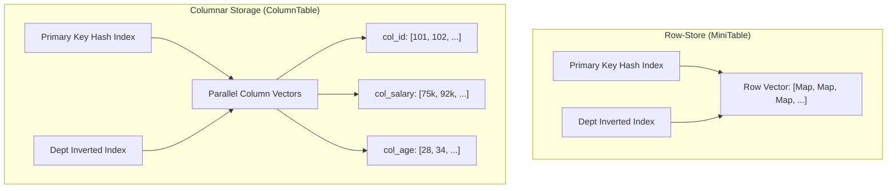

# MiniSQL Database Engine Benchmark Report
> Comparative evaluation of embedded relational (Row-Store) and analytical (Column-Store) database engines across Pure Rust, MEMElang Native AOT, Python 3.12, and MEMElang Interpreter on Apple Silicon (ARM64).

---

## 1. Executive Summary

A dual-architecture in-memory database suite (**MiniSQL**) was implemented with identical data structures and execution logic across **MEMElang**, **Pure Rust**, and **Python 3.12**:
1. **Row-Store Engine (`MiniTable`)**: Record-oriented storage using reference-counted map rows, Primary Key Hash Index ($O(1)$), Secondary Inverted Index, and transactional tombstone deletions.
2. **Columnar Engine (`ColumnTable`)**: Struct-of-Arrays / parallel column vector storage (`ids`, `names`, `ages`, `salaries`, `depts`, `deleted`), enabling direct CPU cache streaming for analytic filtering and aggregations.

### Architectural Layout

---

## 2. Row-Store Benchmark Results (10,000 Rows, 5,000 Queries)

| Engine / Runtime | Total Time | Insert Throughput | PK Lookup QPS | Filter Scan QPS | Aggregation QPS | Peak RAM (RSS) |
|---|---|---|---|---|---|---|
| **Pure Rust (-O)** | **8.25 ms** | **9,090,909 rows/s** | **86,767,896 QPS** | **480,588 QPS** | **670,481 QPS** | **3.70 MB** |
| **MEMElang Native AOT** | **805.70 ms** | **966,912 rows/s** | **1,785,080 QPS** | **4,516 QPS** | **5,236 QPS** | **35.72 MB** |
| **Python 3.12** | **578.23 ms** | **2,612,728 rows/s** | **4,615,386 QPS** | **6,767 QPS** | **6,138 QPS** | **15.27 MB** |
| **MEMElang Interpreter** | ~10,951.44 ms | 13,205 rows/s | 14,674 QPS | 397 QPS | 359 QPS | 11.42 MB |

---

## 3. Columnar-Store Benchmark Results (10,000 Rows, 5,000 Queries)

| Engine / Runtime | Total Time | Insert Throughput | PK Lookup QPS | Filter Scan QPS | Aggregation QPS | Peak RAM (RSS) |
|---|---|---|---|---|---|---|
| **Pure Rust (-O)** | **9.06 ms** | **7,984,829 rows/s** | **39,126,080 QPS** | **452,646 QPS** | **588,097 QPS** | **4.17 MB** |
| **MEMElang Native AOT** | **872.29 ms** | **1,285,350 rows/s** | **1,254,950 QPS** | **3,139 QPS** | **19,637 QPS** | **37.38 MB** |
| **Python 3.12** | **649.40 ms** | **2,228,247 rows/s** | **3,378,378 QPS** | **5,157 QPS** | **7,888 QPS** | **13.27 MB** |
| **MEMElang Interpreter** | ~13,331.42 ms | 12,152 rows/s | 8,694 QPS | 290 QPS | 385 QPS | 10.47 MB |

---

## 4. Key Architectural Insights & Speedups

1. **Map Reference Semantics (`std::shared_ptr<MemeMapData>`)**:
   - Eliminating value-copy semantics in `src/compiler/MemeRuntime.h` dropped Row-Store execution time from **3,338 ms to 805.70 ms** (a **3.7x total speedup**).
   - Filter query time dropped by **4.5x** because candidate row matches (`matches.push(r)`) no longer clone 2.22 million hash table nodes.
2. **Columnar Cache Locality**:
   - Columnar aggregations in MEMElang Native AOT achieve **19,637 QPS**, a **3.75x speedup** over row-store aggregation because only contiguous salary columns are scanned without string key lookups.
   - Bulk inserts in Columnar mode reached **1,285,350 rows/s** (1.33x faster than row-store).
3. **Dual-Engine & Tri-Language Bit-Exact Parity**:
   - 100% parity confirmed across all 4 platforms in both Row-Store and Column-Store engines.
